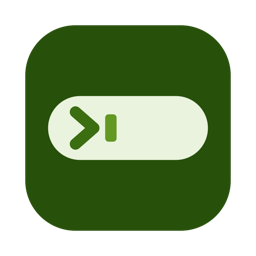
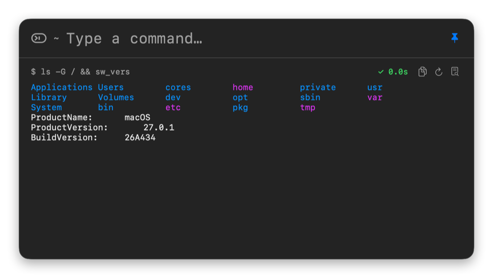
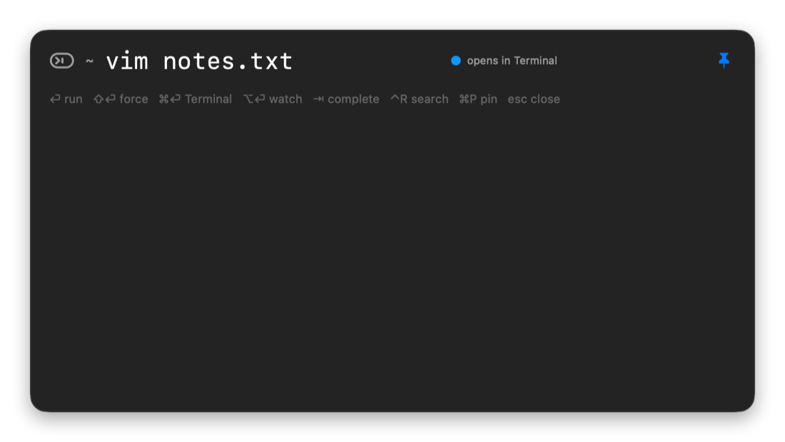
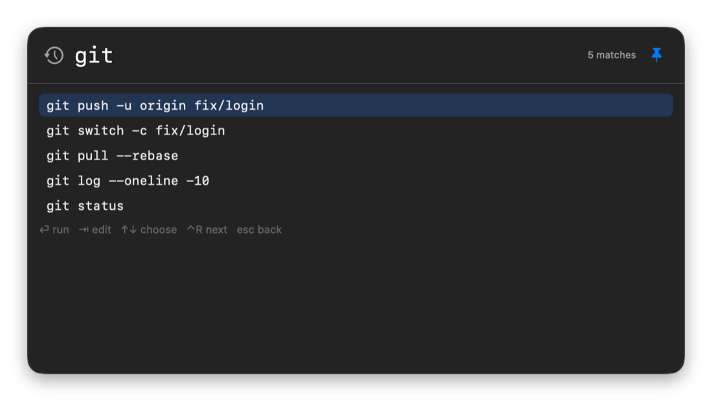
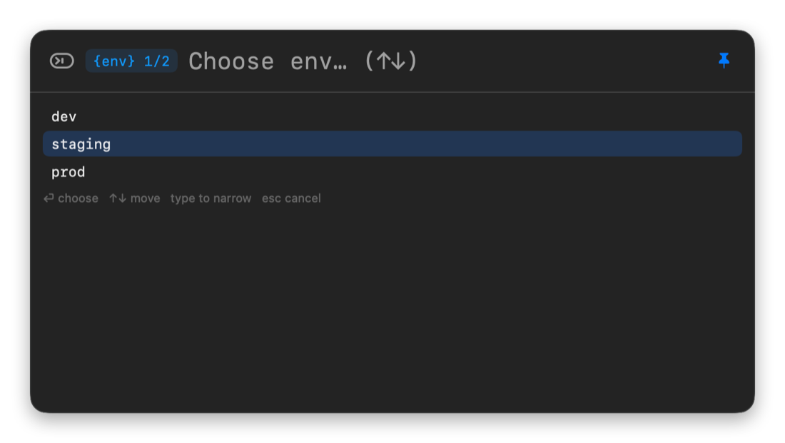

<p align="center"></p>

# Termight

A quick way to run shell commands on your Mac without opening Terminal. Hit
⌥Space, type a command, press Return, and the output shows up in a small
floating bar.



## What it does

- Runs commands from a hotkey bar, with color output, history (⌃R) and Tab completion
- Tells you before you press Return whether a command will work
- Opens anything that needs a real terminal (`vim`, `ssh`, `top`) in Terminal
- Runs several commands at once and lists them in the menu bar
- Watches a command with ⌥Return, rerunning it every few seconds
- Keeps a command's output in the menu bar, like your IP or a build status
- Snippets: short names for long commands, with values filled in when you run them
- Runs snippets on files from Finder (right-click → Quick Actions → Run in Termight)
- Works from Spotlight and Shortcuts, once you allow it in Settings
- Updates itself

| Needs a real terminal | Search history with ⌃R |
|---|---|
|  |  |

## Snippets

Add them in Settings → Snippets, then type the name to run one.

| Name | Command |
|---|---|
| `gs` | `git status` |
| `deploy` | `./deploy.sh {env\|dev\|staging\|prod} --tag {tag:latest}` |
| `api` | `curl -H "Authorization: Bearer {!token}" {url}` |

Termight asks for anything you didn't type. `{!token}` comes from your
Keychain and never shows up on screen or in your history.



## Good to know

- Spotlight and Shortcuts can run commands without asking, so that's off until
  you turn it on.
- Everything stays on your Mac. The only thing Termight sends anywhere is a
  daily check for updates.
- Start a command with a space to keep it out of your history.

The [guide](docs/guide.md) has the keys, the snippet rules and the limits.

## Install

With Homebrew:

```bash
brew install --cask davidnordqvist/termight/termight
```

Or download the latest `.dmg` from
[Releases](https://github.com/DavidNordqvist/Termight/releases/latest) and drag
Termight to Applications. You'll need macOS 26 or later on Apple Silicon.

To build it yourself, you need Xcode and Rust:

```bash
git clone https://github.com/DavidNordqvist/Termight.git
cd Termight
./build.sh
```

Set your team in Xcode first (Signing & Capabilities). A free Apple ID works.

## License

[GPL 3](LICENSE).
